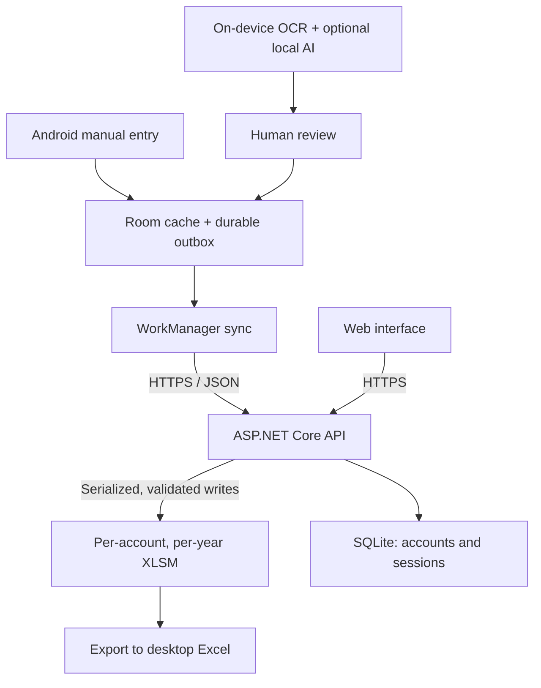

<p align="center">
  <picture>
    <source media="(prefers-color-scheme: dark)" srcset="docs/product/branding/lajur-logo-dark.svg">
    
  </picture>
</p>

<p align="center"><strong>Catat cepat, Excel tetap milikmu.</strong><br>Capture transactions on your phone. Keep your finances in your own Excel workbook.</p>

<p align="center">
  <a href="https://github.com/quenzvezda/lajur/actions/workflows/ci.yml"></a>
  <a href="https://github.com/quenzvezda/lajur/releases/latest"></a>
</p>

<p align="center">
  <a href="https://lajur.solusi-program.online">Open web app</a> ·
  <a href="https://github.com/quenzvezda/lajur/releases/latest">Download Android APK</a> ·
  <a href="docs/index.md">Documentation</a>
</p>

Lajur is a personal-finance application with an offline-first Android client and
a web interface, backed by a self-hosted ASP.NET Core API. It makes daily income
and expense entry faster while keeping a macro-enabled Excel (`.xlsm`) workbook
as the financial source of truth.

Built for people who already use a structured finance workbook, Lajur preserves
the reports, formulas, and macros they rely on. Each account has its own annual
workbooks, which can be exported and used independently in desktop Excel.
The current interface uses Indonesian labels and integer IDR amounts.

## Try Lajur

**Web app:** [lajur.solusi-program.site](https://lajur.solusi-program.site)

The hosted service requires an account, and registration is **invite-only**.
If you would like to try Lajur, **contact me to request an invite code**.

1. Obtain an invite code and create an account through the web app or Android app.
2. Save the recovery codes shown during registration for future account recovery.
3. Create a new workbook or import a compatible Lajur `.xlsm` workbook.
4. Start recording transactions in the browser or on Android.

For Android, download the signed APK from
[GitHub Releases](https://github.com/quenzvezda/lajur/releases/latest)
and install it on Android 8.0 or later. The release app uses the hosted service
by default; the server address can also be changed for a self-hosted instance.
Update checks are available from Login and Settings.

## What you can do

| Capability | Android | Web |
| --- | --- | --- |
| Transaction entry | Create, edit, and delete; browse, search, and filter by month | Create, edit, and delete monthly transactions |
| Offline entry | Save locally and synchronize when connected | Requires a connection |
| Smart Scan | Camera, gallery, or shared payment screenshot; review before saving | — |
| Insights | Monthly summaries, categories, trends, and cached reports | Workbook views and supplemental reports |
| Workbook management | Create annual workbooks, import XLSM, export a year or all years | Workbook views, budget/projection settings, category and payment management |
| Account security | Biometric app lock, password and recovery-code management | Password and recovery-code management |

Smart Scan runs OCR and extraction on the Android device. The initial draft uses
OCR evidence and deterministic rules; optional local AI suggestions can help with
semantic fields. Receipt images and raw OCR text are not uploaded for inference.
Scan results always require human review before saving. Local-model quality and
device performance remain under evaluation.

## Architecture



The workbook owns synchronized financial data. Android holds a local cache and
pending commands; server SQLite stores authentication and infrastructure metadata.
The browser and Android share the same workbook service.

### Engineering decisions

- **Durable offline writes.** Android saves a transaction and its outbox operation
  together in Room. WorkManager retries synchronization, and client-generated
  transaction IDs make creates idempotent.
- **Explicit conflict handling.** Optimistic revisions reject stale edits and
  deletes. Workbook writes are serialized per account and year.
- **Workbook preservation.** The backend edits Open XML packages on Linux,
  preserving VBA, formulas, tables, defined names, formatting, and unrelated
  package parts. Monthly transaction tables stay within `A:F`; identity,
  revision, and audit metadata live on hidden sheets.
- **Validated replacement.** Workbook changes use temporary copies, validation,
  and atomic replacement. Imports are validated before replacing an active file.
- **Local scan processing.** OCR and optional LLM inference run on-device, with
  evidence-based date/amount extraction and a mandatory review step.
- **Account isolation.** Workbook paths derive from immutable account IDs.
  Browser cookie sessions and Android token sessions have separate boundaries.

See the [architecture overview](ARCHITECTURE.md),
[Excel contract](docs/architecture/EXCEL_CONTRACT.md),
[sync protocol](docs/architecture/SYNC_PROTOCOL.md), and
[decision records](docs/adr/README.md) for the reasoning and contracts.

## Technology

| Area | Stack |
| --- | --- |
| Android | Kotlin, Jetpack Compose, Room, WorkManager, DataStore |
| Device security | BiometricPrompt, Android Keystore-backed encryption |
| Backend and web | ASP.NET Core, .NET 10 |
| Financial storage | Per-account, per-year macro-enabled Excel workbooks |
| Auth storage | SQLite |
| Workbook adapter | Open XML package manipulation |
| Hosting and delivery | Docker, Linux VPS, HTTPS reverse proxy, GitHub Actions |

## Run locally

Prerequisites: .NET 10 SDK for the backend; Android Studio, its JDK, and the
Android SDK for the mobile client. Docker is optional for containerized setup.
The commands below run from the repository root in PowerShell.

```powershell
git clone https://github.com/quenzvezda/lajur.git
cd lajur

dotnet restore services/api/Lajur.slnx
dotnet run --project services/api/src/Lajur.Api
```

Before using authenticated finance features, follow
[local setup](docs/development/LOCAL_SETUP.md) to create a development account,
configure a compatible workbook template, and connect a device or emulator.
Private runtime templates, credentials, and real financial data are excluded
from the repository; tests use committed sanitized workbook fixtures.

Build and verify each application independently:

```powershell
# Backend unit, API integration, and workbook tests
dotnet test services/api/Lajur.slnx

# Android JVM tests and debug APK
.\apps\android\gradlew.bat -p apps/android testDebugUnitTest assembleDebug
```

For container setup, deployment, and release operations, see
[local setup](docs/development/LOCAL_SETUP.md),
[deployment](docs/operations/DEPLOYMENT.md),
[backend CI/CD](docs/operations/BACKEND_RELEASE.md), and
[Android releases](docs/operations/ANDROID_RELEASE.md).

## Quality and project scope

Lajur is actively developed, with a hosted service and signed Android releases.
The test suite covers domain rules, API authorization and account isolation,
idempotency, revision conflicts, and workbook preservation. Android verification
includes JVM tests, lint, and targeted device smoke checks. See the
[test strategy](docs/testing/TEST_STRATEGY.md) and
[known issues](docs/development/KNOWN_ISSUES.md) for coverage and open limitations.

The current scope assumes one active Android device per account and independent
workbooks for each user. Imports require the documented workbook structure;
arbitrary spreadsheets are not supported. Desktop Excel edits use the
export → edit → import workflow rather than concurrent editing of the server file.

Explicit non-goals for v1 are shared workbook collaboration, bank/e-wallet API
aggregation, cloud OCR/LLM inference, and a full accounting suite. The web
interface requires connectivity; offline transaction capture belongs to Android.

## Explore the repository

```text
apps/android/              Native Android client
services/api/              API, web interface, workbook adapter, and backend tests
tests/workbook-fixtures/   Sanitized XLSM regression fixtures
docs/                     Product specs, architecture, decisions, and runbooks
docker-compose.yml        Local container stack
```

Start with the [documentation index](docs/index.md) or
[architecture overview](ARCHITECTURE.md). Implementation work follows
[AGENTS.md](AGENTS.md) and the
[active execution plan](docs/exec-plans/active/0001-mvp.md).
